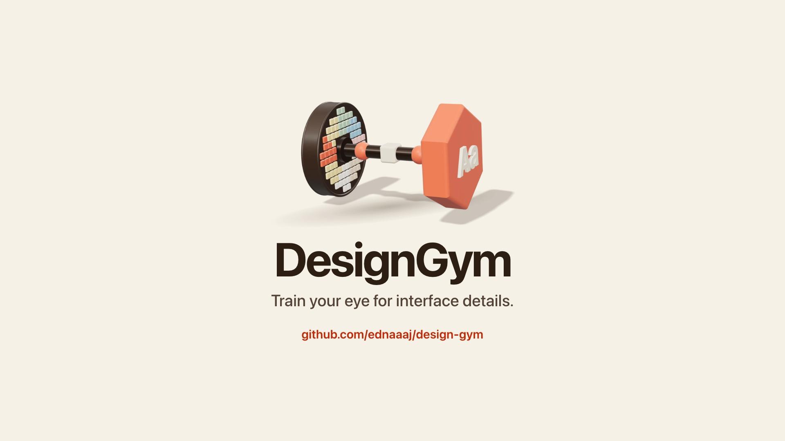
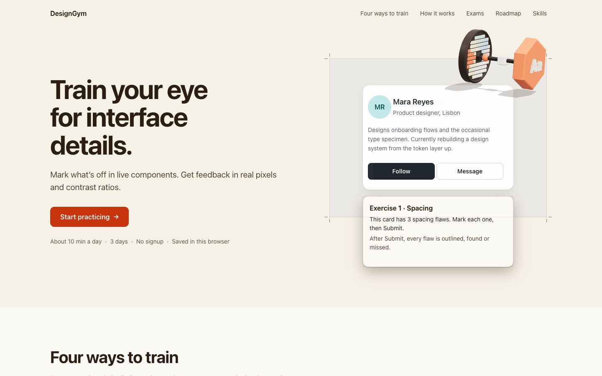
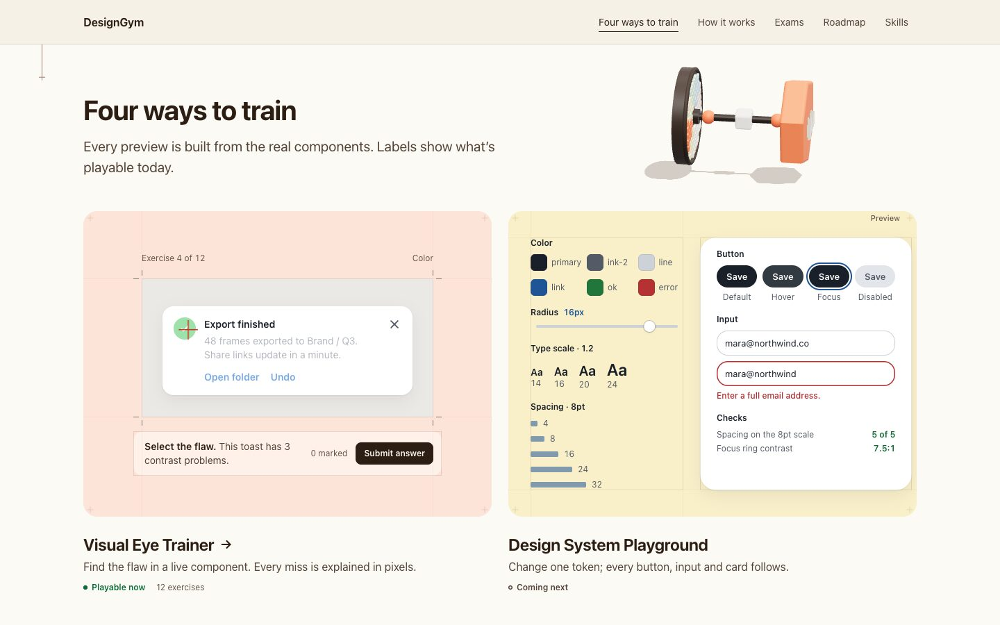
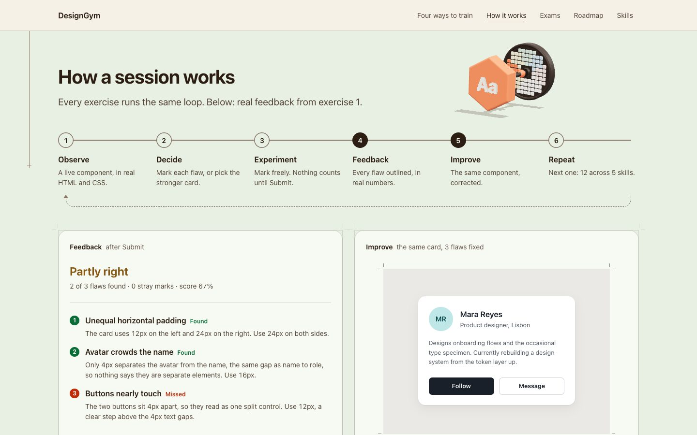
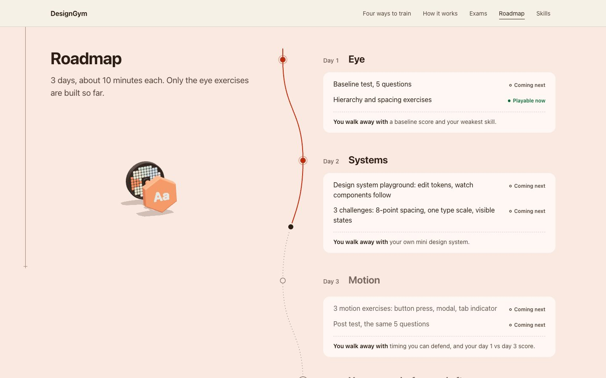
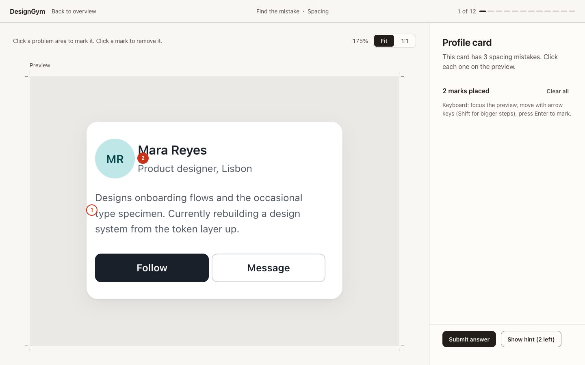
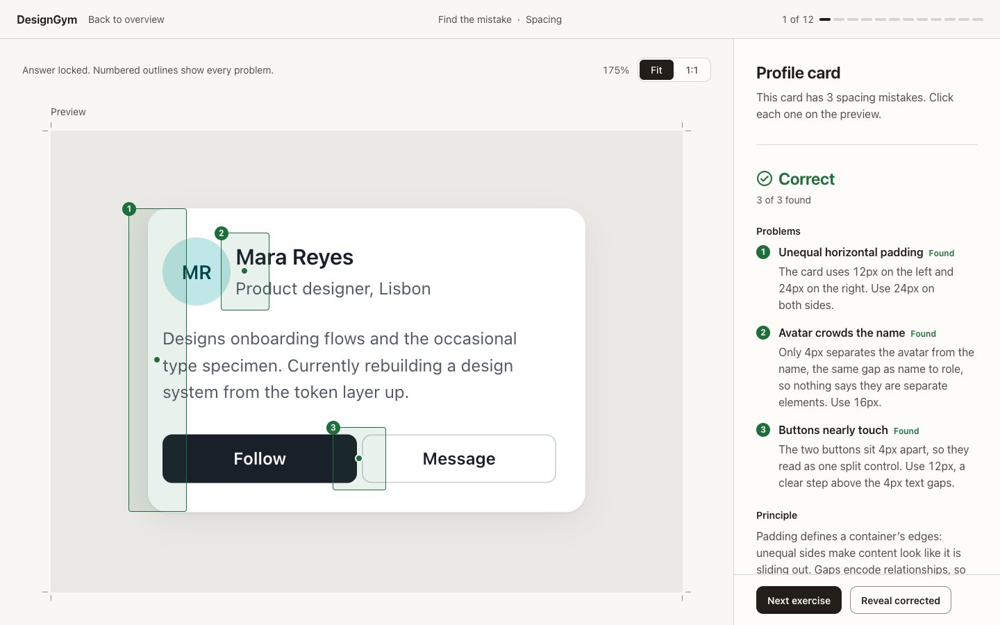

# DesignGym

Hands-on training lab for design engineers. Learn to notice details and make better visual decisions by practicing, not reading: 20% learning, 80% practice.

Desktop only (1024px and up). No backend, no signup. Progress is saved in your browser's `localStorage`.

[](docs/brag.mp4)

[Watch the 20s launch video](docs/brag.mp4)

## Status

| Part | Status |
|---|---|
| Visual Eye Trainer (12 exercises) | Playable |
| Per-skill accuracy | Playable |
| Landing page with 3D intro | Done |
| Baseline and post test | Next |
| Design System Playground | Next |
| Motion Lab | Next |
| Design briefs with before/after | Planned |

Full plan: [SPEC.md](SPEC.md).

## Screenshots

| | |
|---|---|
| <br>**Landing.** The 3D dumbbell flies into the hero, and the demo marks real flaws. | <br>**Four ways to train.** Previews are built from the real components. Labels show what's playable. |
| <br>**How a session works.** Observe, decide, experiment, feedback, improve, repeat. | <br>**Roadmap.** Three days, scroll-driven route. Only the Eye exercises are built so far. |
| <br>**Practice arena.** Click the problems on a live component. | <br>**Feedback.** Every flaw explained in pixels, with the principle behind it. |

## Run it

```bash
cd app
npm install
npm run dev
```

Other scripts: `npm run build`, `npm run lint`, `npm test`.

## Stack

React, TypeScript, Vite, plain CSS with OKLCH tokens. `three` powers the landing page's 3D dumbbell and is lazy-loaded; a WebP fallback shows without WebGL or with reduced motion.

## Layout

```
app/src/exercises   exercise data and live sample components
app/src/lib         scoring, stats, storage, motion helpers (with tests)
app/src/screens     landing page and practice arena
app/src/three       3D dumbbell scene
```
